# Snowflake + Databricks Lakehouse: Supply Chain Analytics

The same supply chain dataset, modeled as a star schema on **Snowflake (SQL + dbt)** and on **Databricks (PySpark + Delta Lake)**, connected by a hand-off between the two platforms and reconciled row by row.

I built this to learn both platforms side by side, using only free tiers, and to practice SQL on realistic operations and finance questions.

## Business questions answered

- Which product categories earn the most profit in each market?
- How does profit change month to month?
- Which shipping modes deliver late most often, and by how much?
- Do bigger discounts lead to more loss-making order items?
- Can the data be trusted? (data quality checks)

One result stands out: **First Class shipping is late on 95.3% of items**, while Standard Class is late on 38.1%. The most expensive option performs worst on punctuality.

## Architecture

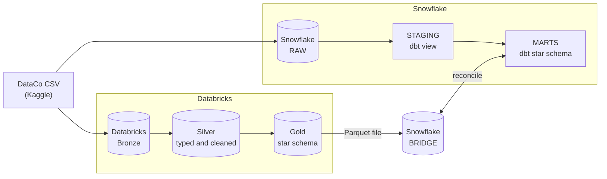

## Dataset

[DataCo Smart Supply Chain for Big Data Analysis](https://www.kaggle.com/datasets/shashwatwork/dataco-smart-supply-chain-for-big-data-analysis) (Kaggle): about 180,000 order items with 53 columns covering customers, products, shipping, delivery status, sales, discounts, and profit. Originally published on Mendeley Data. The data is not included in this repo, so download it from Kaggle.

Notes on handling it:
- The CSV is encoded in ISO-8859-1, not UTF-8, which needed an explicit encoding setting on both platforms.
- Customer email, customer password, and product image columns are dropped in the staging layer.

## Stack

| Layer | Tools |
|---|---|
| Warehouse | Snowflake (trial) |
| Transformation | dbt Core 1.12 with the Snowflake adapter |
| Lakehouse | Databricks Free Edition: serverless compute, Unity Catalog, Delta Lake |
| Languages | SQL (Snowflake and Spark SQL), Python / PySpark |
| Tooling | Git and GitHub, VS Code, SQLFluff |

## Repository layout

```
databricks/        Notebooks: bronze, silver, gold, Delta demos, export, SQL analysis
dbt_project/       dbt models (staging, marts), tests, macros
snowflake/         Setup, load, feature demos, bridge scripts (run in numeric order)
sql/analysis/      Five business-question queries for Snowflake
docs/              Dialect differences doc and screenshots
requirements.txt   Python packages
```

## Snowflake and dbt

- **Load:** CSV to an internal stage, then `COPY INTO` a raw table, with the schema inferred from the file header (`snowflake/01` to `03`).
- **Staging (dbt):** one model that renames the 53 columns to snake_case, drops sensitive columns, converts the date columns to timestamps, and casts money columns to `NUMBER(18,2)`.
- **Marts (dbt):** star schema with `fct_order_items` (one row per order item) and the dimensions `dim_customer`, `dim_product`, `dim_geography`, `dim_shipping_mode`, and `dim_date`.
- **Tests:** 22 dbt data tests (unique, not null, and relationships from the fact table to every dimension), all passing.
- **Authentication:** key pair authentication for dbt instead of a password.

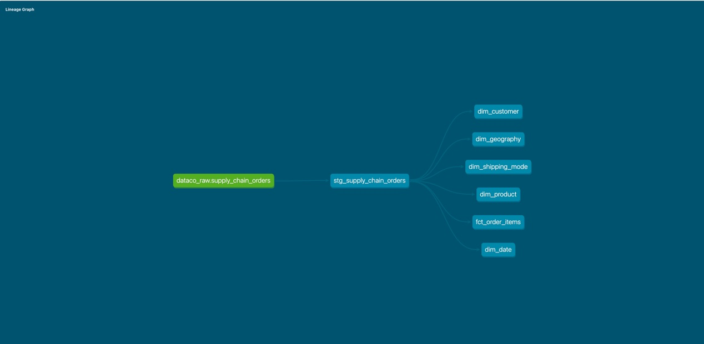

## Databricks: medallion architecture and Delta Lake

| Layer | Notebook | What it does |
|---|---|---|
| Bronze | [`01_bronze_load`](databricks/01_bronze_load.ipynb) | Raw CSV loaded as Delta, all text, columns renamed to snake_case |
| Silver | [`02_silver_clean`](databricks/02_silver_clean.ipynb) | Typed columns (`try_cast`, `try_to_timestamp`), sensitive columns dropped |
| Gold | [`03_gold_star_schema`](databricks/03_gold_star_schema.ipynb) | The same star schema as the dbt marts, with identical column names and `md5` keys |
| Delta demos | [`04_delta_lake_demo`](databricks/04_delta_lake_demo.ipynb) | Time travel and `RESTORE`, `MERGE`, `OPTIMIZE` |

Delta time travel on a copy of the fact table: damage it on purpose, then restore it.

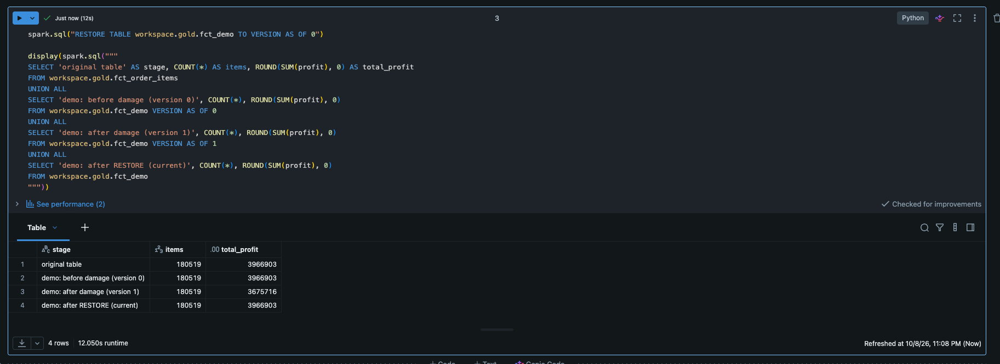

`MERGE` updating 3 rows and inserting 2 in one statement:

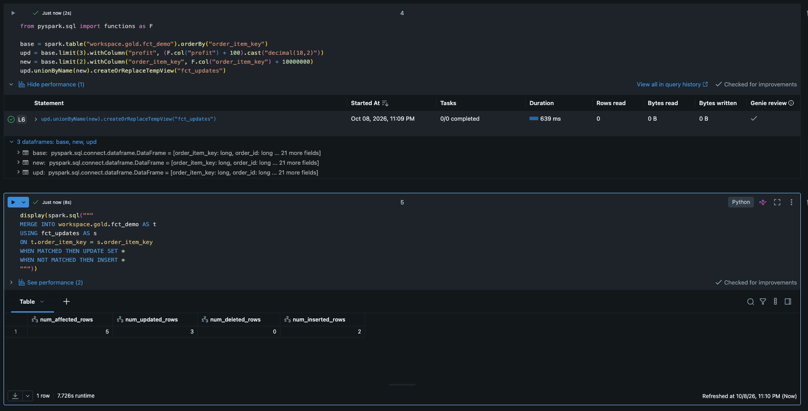

## SQL analysis

Five queries in [`sql/analysis/`](sql/analysis), each with a header describing the business question and the SQL skills it shows. The same analysis runs on Databricks in [`06_sql_analysis`](databricks/06_sql_analysis.ipynb).

| Query | Skills shown |
|---|---|
| [`01_top_categories_per_market`](sql/analysis/01_top_categories_per_market.sql) | Multi-table joins, `RANK()`, `QUALIFY` |
| [`02_monthly_profit_trend`](sql/analysis/02_monthly_profit_trend.sql) | CTEs, `LAG()`, moving average window frame |
| [`03_delivery_performance`](sql/analysis/03_delivery_performance.sql) | Conditional aggregation, percentiles |
| [`04_loss_making_items_by_discount`](sql/analysis/04_loss_making_items_by_discount.sql) | CTEs, `CASE` bucketing |
| [`05_data_quality_checks`](sql/analysis/05_data_quality_checks.sql) | `UNION ALL` validation checks, anti-join |

Delivery performance by shipping mode on both platforms:

| Snowflake | Databricks |
|---|---|
| 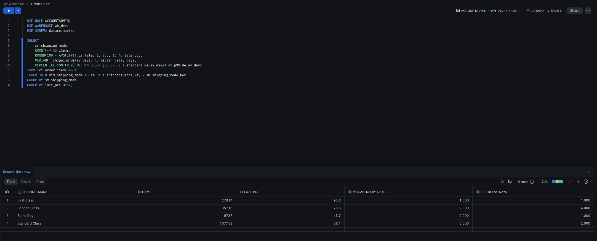 | 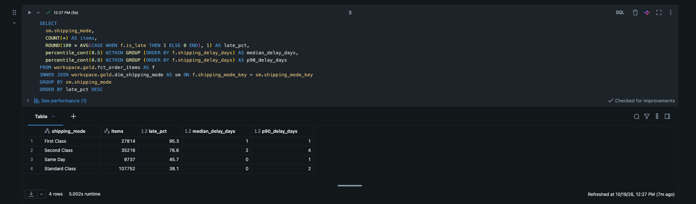 |

See [`docs/dialect_differences.md`](docs/dialect_differences.md) for the syntax differences I ran into (`IFF` vs `CASE`, `QUALIFY`, date parsing, time travel, and more).

## Snowflake features

Script: [`snowflake/04_features_demo.sql`](snowflake/04_features_demo.sql)

**Zero-copy clone and time travel.** A clone of the fact table is damaged on purpose, then restored from the moment before the damage. The restored table matches the original exactly. dbt builds transient tables, so the clones had to be transient as well.

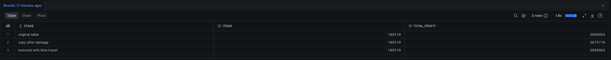

**Role-based access.** A read-only `analyst_role` can query the marts but is blocked from the raw data and from writes. The test needs `USE SECONDARY ROLES NONE`, otherwise privileges from the user's other roles still apply and the test proves nothing.

| Allowed | Blocked on raw data | Blocked on write |
|---|---|---|
| 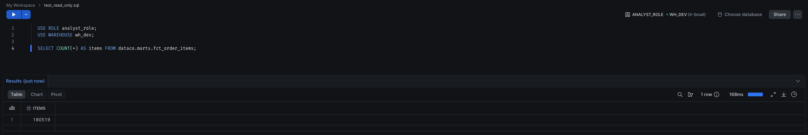 | 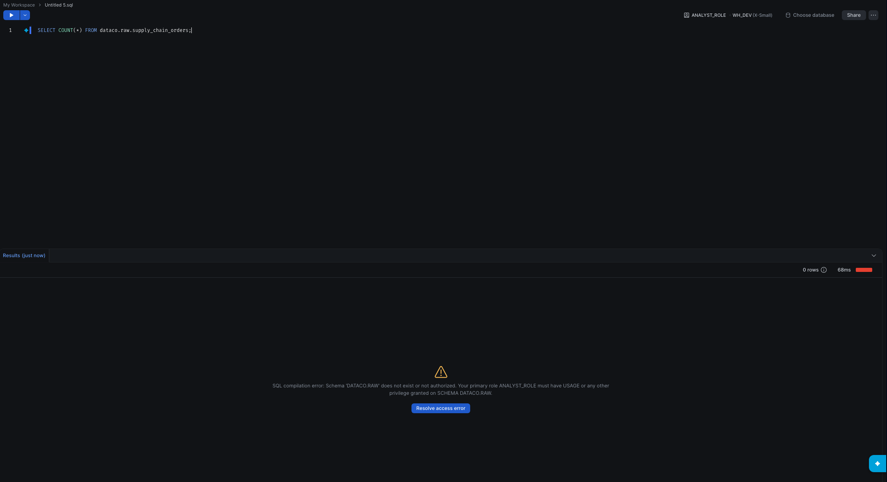 | 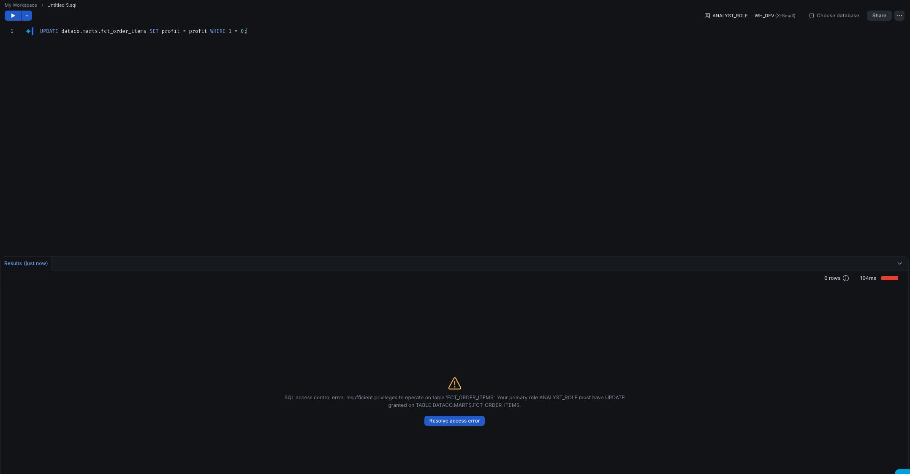 |

**Streams and tasks.** A stream on a cloned table tracks newly added rows, and a task consumes them incrementally, so the same rows are never processed twice. Script: [`snowflake/05_streams_tasks_demo.sql`](snowflake/05_streams_tasks_demo.sql).

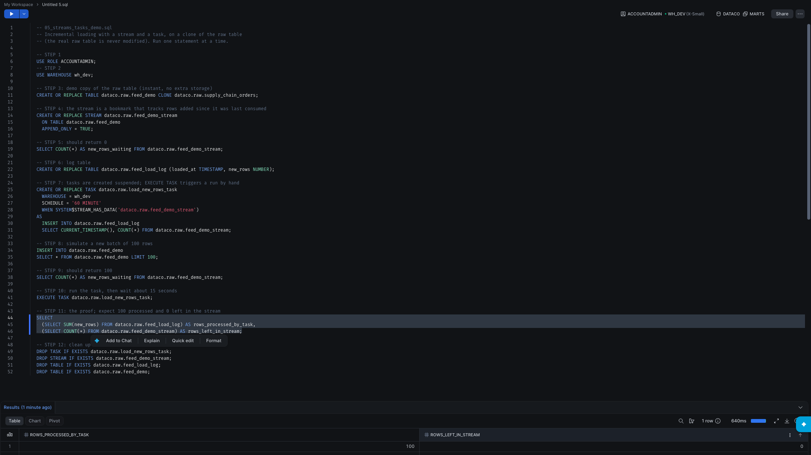

## Bridge: Snowflake and Databricks together

Databricks Free Edition blocks outbound internet access, so a live connection to Snowflake isn't possible. The hand-off is a file instead, which is a common real-world pattern:

1. Databricks writes the gold fact table as a single Parquet file ([`05_export_for_snowflake`](databricks/05_export_for_snowflake.ipynb)).
2. The file is downloaded and uploaded to a Snowflake stage.
3. `COPY INTO` loads it into `dataco.bridge.fct_order_items_dbx` ([`snowflake/06_load_from_databricks.sql`](snowflake/06_load_from_databricks.sql)).
4. The table is reconciled against the dbt-built fact table.

| Check | Snowflake (dbt) | Databricks (via bridge) |
|---|---|---|
| Rows | 180,519 | 180,519 |
| Total profit | 3,966,902.97 | 3,966,902.97 |
| Total sales | 36,784,734.31 | 36,784,734.31 |
| Row-by-row mismatches | 0 | |

**The first reconciliation found a discrepancy.** Total sales differed by 0.70 (36,784,735.01 vs 36,784,734.31) while rows and profit matched.

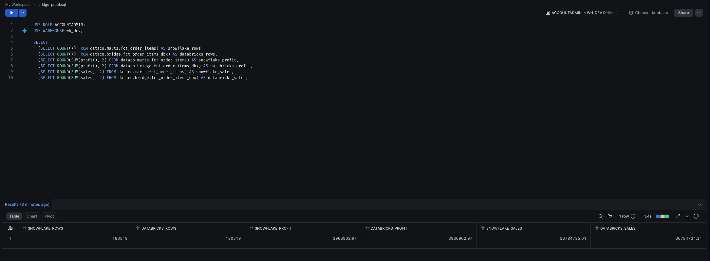

The cause was decimal precision: Databricks stored money as exact cents (`decimal(18,2)`), while Snowflake kept the extra decimals inferred from the CSV. Casting the money columns to `NUMBER(18,2)` in the dbt staging model fixed it.

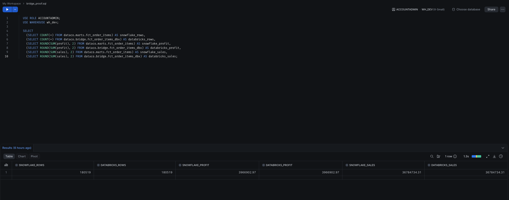

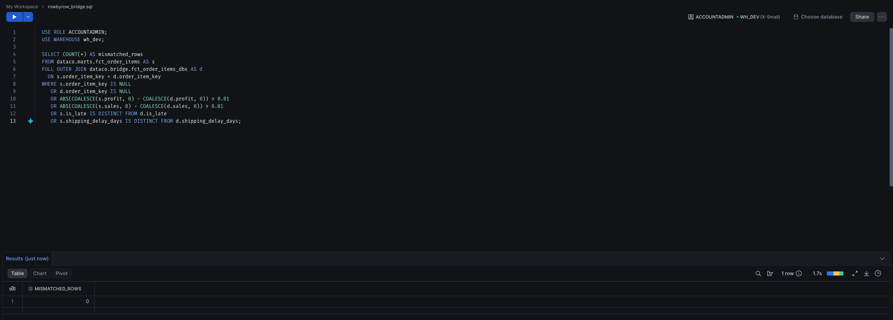

## Snowflake vs Databricks: what I observed

Observations from this project on a small dataset and free tiers, not a benchmark. With 180K rows, timing differences are not meaningful.

| Topic | Snowflake | Databricks |
|---|---|---|
| Getting started | SQL-first, and the web editor was enough to build the whole warehouse | Notebook-first, with Python and SQL side by side |
| Transformation | dbt models with tests and lineage | PySpark and Spark SQL in notebooks |
| Undo / history | Time travel with `BEFORE(STATEMENT => ...)`, plus clones | `DESCRIBE HISTORY`, `VERSION AS OF`, `RESTORE TABLE` |
| Incremental loading | Streams and tasks | `MERGE` into Delta tables |
| Strictness | Lenient type conversion | ANSI mode on serverless, so `try_cast` was needed |
| Governance | Roles and grants | Unity Catalog catalogs, schemas, and volumes |

Both platforms produced identical results from the same logic, which is the main takeaway: the modeling matters more than the engine.

## Lessons learned

- **Type inference differs between platforms.** I now enforce explicit types instead of trusting inference.
- **Check file encodings early.** The CSV needed ISO-8859-1 on both platforms.
- **dbt creates transient tables in Snowflake by default**, and clones of them must be transient too.
- **Test access control with secondary roles off**, or the test can pass for the wrong reason.
- **Prefer key pair authentication** over passwords for tools like dbt.
- **Reconcile across platforms instead of assuming they agree.** Doing so exposed a precision gap I would not have noticed.

## Limitations and next steps

- Small dataset and free tiers, so no performance conclusions.
- The bridge is a manual file hand-off. In production I would use a native connector or a shared open table format such as Apache Iceberg (not tested here), with an orchestrator.
- No scheduled pipeline or CI yet. A GitHub Action that lints the SQL is a planned next step.

## How to reproduce

1. Download the dataset from Kaggle (link above).
2. Create a Python virtual environment and run `pip install -r requirements.txt`.
3. Snowflake: run `snowflake/01` to `03` in order, upload the CSV to the stage as described in the scripts, then configure dbt (a `profiles.yml` with key pair authentication, kept outside the repo) and run `dbt build` inside `dbt_project/`.
4. Databricks: upload the CSV to a Unity Catalog volume and run notebooks `01` to `04`.
5. Bridge: run `05_export_for_snowflake`, upload the Parquet file to the Snowflake stage, then run `snowflake/06_load_from_databricks.sql`.

No credentials are stored in this repo.

## Author

Leopoldo Lugo ([@PoloLugoR](https://github.com/PoloLugoR))